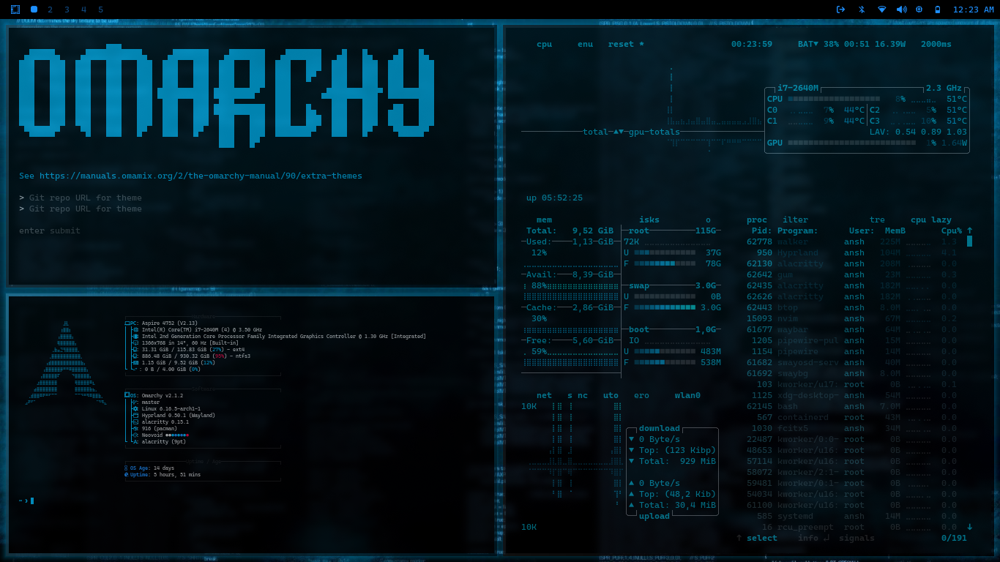

# nodaysidle Voidline — Omarchy Theme

> *"True pitch OLED void, electric laser telemetry, zero compromise."*

A cyber-minimalist, high-contrast theme for **Omarchy / Hyprland**, custom-tailored for the **nodaysidle** ecosystem. Inspired by **neovoid** and F1 racing telemetry displays.

Tuned for high-velocity coding, instant visual orientation, and pure OLED contrast. Eliminates window blur and decorative bloat in favor of surgical laser cyan accents cutting through an absolute pitch-black abyss.



---

## Design System & Color Tokens

Anchored in an absolute `#000000` void ground with electric laser cyan telemetry signals and icy white typography:

| Token | Hex | Role in Ecosystem |
| :--- | :--- | :--- |
| **Pitch Void** | `#000000` | Pure true black background (zero light emission on OLED) |
| **Circuit Surface** | `#07080B` | Sunken and elevated containers, tooltips |
| **Laser Cyan** | `#00E5FF` | Active window border, primary accent, focused highlights |
| **Deep Cyan** | `#005577` | Border gradient depth |
| **Telemetry Cobalt** | `#1E90FF` | Memory & download meters, secondary accent |
| **Telemetry Red** | `#FF0055` | Critical alerts, thermal peaks, urgent notifications |
| **Laser Emerald** | `#00FFB2` | Success states, upload meters, network pulse |
| **Icy White** | `#EEF2F6` | Razor-sharp typography (JetBrains Mono Nerd Font) |
| **Circuit Slate** | `#3A4454` | Inactive borders, metadata, code comments |

---

## Key Architectural Features

### 1. Razor-Sharp Telemetry Geometry
`rounding = 0` with zero blur overhead for maximum rendering speed and crystalline text legibility on high-refresh displays.

### 2. Laser Cyan Aura
A 2px high-voltage active border (`#00E5FF` $\rightarrow$ `#005577`) paired with a tight 20px cyan shadow bloom (`rgba(0, 229, 255, 0.22)`) giving focused windows an electric presence.

### 3. Ghostty & Herdr Cockpit Integration
Engineered from the ground up for **Ghostty** and the **Herdr** agent workspace multiplexer:
- Ghostty palette config with electric laser cyan cursor and deep selection highlights
- Live hot-reload support (`SIGUSR2`) on theme switch
- Matched window rules for `com.mitchellh.ghostty` and `title = "^Herdr.*"` with full opacity

### 4. Bespoke Top Menu Bar Surfaces
`shell.toml` configures an ultra-dense, zero-bleed status bar:
- **Pitch Black Bar**: `background = "#000000"` with solid `alpha = 1.00`
- **Laser Cyan Rim**: Thin border (`#00E5FF`) defining active states
- **Telemetry Readouts**: Memory, CPU, and agent activity rendered in high-contrast neon tokens

### 5. Curated High-Resolution Wallpapers
Includes 6 bespoke OLED void & cyber telemetry wallpapers:
- `01-voidline-laser-minimal.jpg`: Razor-sharp minimal horizon line.
- `02-voidline-cyber-void.jpg`: Deep cyber matrix wireframe on black.
- `03-voidline-pitch-telemetry.jpg`: True OLED pitch black telemetry line.
- `04-voidline-laser-filament.jpg`: Electric cyan filament on pure void.
- `05-voidline-cyan-horizon.jpg`: Cyber telemetry horizon.
- `06-voidline-minimal-hud.png`: Procedural 2560×1440 laser HUD reticle.

---

## Installation & Activation

### 1. Register the Theme
Clone and run the installer from inside the repository:

```bash
git clone https://github.com/nodaysidle/omarchy-theme-nodaysidle-voidline.git
cd omarchy-theme-nodaysidle-voidline
chmod +x install uninstall hooks/nodaysidle-voidline
./install
```

### 2. Activate with Omarchy
```bash
omarchy theme set nodaysidle-voidline
```

### 3. Cycle Wallpapers
```bash
omarchy theme bg next
```
*(or press `Super + Ctrl + Space` for the visual wallpaper picker)*

---

## File Architecture

```
omarchy-theme-nodaysidle-voidline/
├── colors.toml               # Master color tokens for Omarchy templates
├── hyprland.lua              # 90° laser cyan gradient, 0px sharp corners, laser pulse
├── shell.toml                # Monolithic bar, controls, popups, and OSD
├── ghostty.conf              # Ghostty terminal palette & cursor definition
├── foot.ini                  # Foot terminal fallback config
├── btop.theme                # Telemetry skin for system monitoring
├── preview.png               # Screenshot for Omarchy theme picker
├── install / uninstall       # Symlink & hook registration scripts
├── hooks/
│   └── nodaysidle-voidline   # Omarchy theme-set lifecycle hook
└── backgrounds/              # Six OLED void & telemetry wallpapers
```

---

## Built for NODAYSIDLE
Part of the [nodaysidle](https://github.com/nodaysidle) workspace — relentless shipping, zero compromise.
